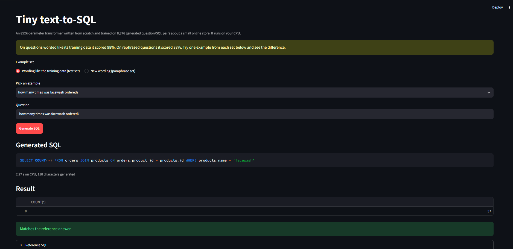
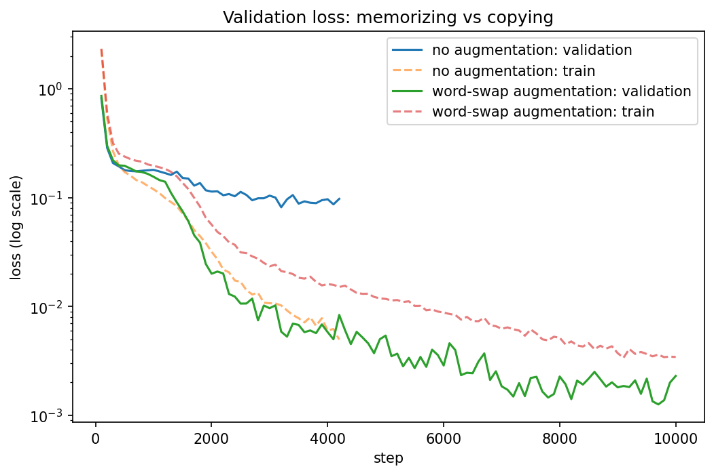
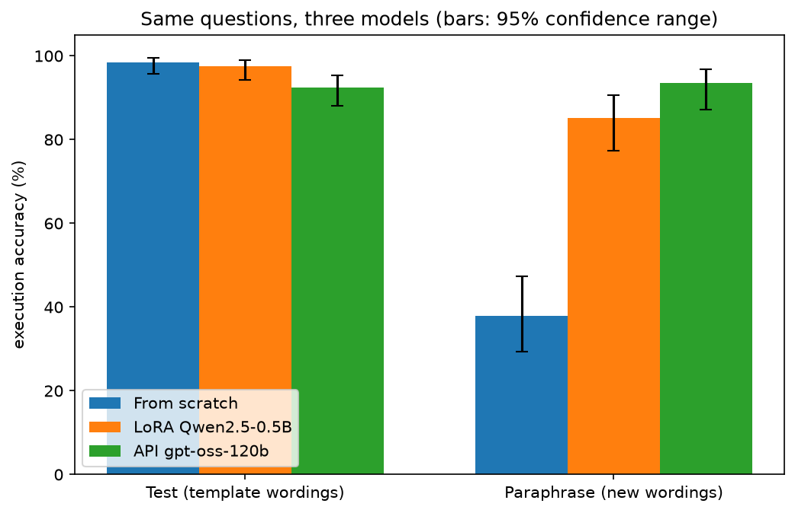
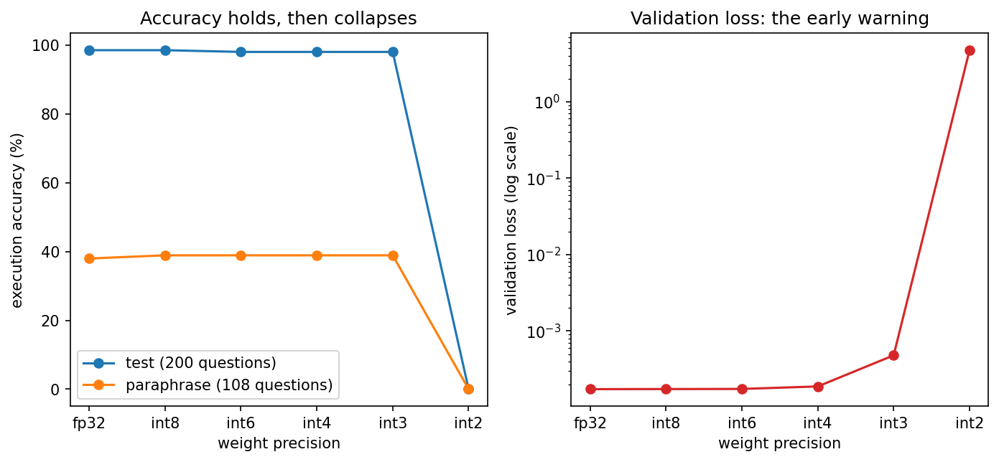

# Tiny Transformer Lab

**How small can a model be and still turn English questions into correct SQL?**

I trained a GPT-style transformer from scratch (852k parameters), fine-tuned a pretrained model with LoRA, prompted a 120B-parameter hosted model, and compared all three on the *same questions*, with confidence intervals and paired significance tests. Along the way the from-scratch model went from 39.5% to 99.1% validation accuracy once I diagnosed *why* it was failing.



## Headline results

| Model | Test, 200 shared questions | Rephrased questions (108) | Size on disk | One question on CPU |
|---|---|---|---|---|
| **From scratch** (852k parameters) | **98.5%** | 38.0% | **3.4 MB** | 0.8 s |
| **LoRA** on Qwen2.5-0.5B (8.8M trained of 494M) | 97.5% | 85.2% | about 1 GB (+ 35 MB adapter) | 5.0 s |
| **API** gpt-oss-120b, 5 examples in the prompt | 92.5% | **93.5%** | hosted | 0.85 s (network included) |

Scores are *execution accuracy*: the generated SQL is run against the database and must return the same rows as the reference query. On the full 1,172-question test split the from-scratch model scores 98.0% and the LoRA model 97.6%.

**What this says:**

- On a narrow task with matching training data, a 3 MB model written from scratch matches a fine-tuned 494M-parameter model and beats a prompted 120B model.
- It is brittle. When the same requests are worded differently, it drops to 38%. Pretraining is what carries over to new wordings (LoRA: 85%), and scale gets a bit further (API: 93.5%).

## Try it

```bash
python -m venv .venv
.venv\Scripts\activate          # Windows; on macOS/Linux: source .venv/bin/activate
pip install -r requirements.txt
streamlit run app/demo.py
```

The 3.4 MB model (`saved_models/tiny_sql.pt`) is in the repo, so the demo runs on a CPU with no downloads. It shows the generated SQL, the rows it returns, and, for the built-in examples, whether the result matches the reference. Pick an example from each of the two sets to see the difference between familiar and rephrased wording.

## The task and the data

A small online store with three tables (`customers`, `products`, `orders`). The model reads a lowercase English question and writes a SQLite query.

All data is generated from templates, so every question has a known correct answer:

| | v1 | v2 (used for the final results) |
|---|---|---|
| Customers / cities | 40 / 6 | 300 / 40 |
| Products / categories | 25 / 5 | 120 / 12 |
| Orders | 400 | 3,000 |
| Question templates | 12 | 20 |
| Wordings per template | 3 | 8 |
| Pairs (train / val / test) | 1,049 / 135 / 134 | 8,376 / 1,172 / 1,172 |

**The split is strict in v2.** Every customer name, city, product, category, date and price belongs to exactly one split, so each validation and test question asks about values the model never saw in training. Each template contributes at most 700 / 100 / 100 pairs, so no single template dominates a score, and trivial answers (empty, `0` or `NULL`) are removed.

**Rephrased set.** 108 questions I wrote with new wordings for each template (for example "customer headcount for {city}" or "what would a {product} set me back?"), filled with held-out test values. None of these wordings appears in training.

## Models

| | From scratch | LoRA | API baseline |
|---|---|---|---|
| Base | Nothing: written in PyTorch | Qwen2.5-0.5B | openai/gpt-oss-120b on Groq |
| Trained | All 851,968 parameters | 8,798,208 adapter parameters (1.75%), rank 16 | Nothing |
| Input | Characters | Word pieces | Schema + 5 examples in the prompt |
| Training | 12,000 steps, about 11 min on a free Colab T4 | Best adapter at step 200, 339 s | None |

- **From scratch:** character-level tokenizer; 4 layers, 4 attention heads, 128-dimensional embeddings, 320-character context, causal self-attention written by hand. AdamW with warmup and cosine decay, gradient clipping, and the checkpoint with the best validation loss kept.
- **Word-swap augmentation:** during training, 80% of word values (names, cities, products, categories) are replaced by random words, consistently in the question and the SQL. Validation and test data are never altered.
- **API baseline:** temperature 0, one fixed prompt (schema, a rule that stored values are lowercase, and five training examples from five templates). The prompt was frozen after a 3-question smoke test and not changed after seeing any evaluation result.

## How the from-scratch model got from 39.5% to 99.1%

| Run | What changed | Validation accuracy | Macro (per-template average) |
|---|---|---|---|
| `v2` | Baseline | 39.5% (an identical rerun: 38.5%) | 33.0% |
| `v2aug` | Word-swap augmentation, 10k steps | 95.6% | 96.2% |
| `v2aug2` | Same augmentation, 12k steps | 99.0% | 99.1% |
| `v2aug3` | Random words also contain doubled letters, 12k steps | **99.1%** | **99.5%** |

(`v2aug2` was meant to include the doubled-letter fix, but a failed `git pull` on Colab meant it ran the earlier augmentation. It is labelled by what it actually used.)

The baseline's validation loss looked fine, but its accuracy did not. Digging into the failures:

1. On the first, smaller dataset (v1), 32 of 35 failures had the right SQL structure and a wrong copied value (`kolkatchi` for `kolkata`).
2. With 300 customers and 120 products, dates were copied with 100% accuracy (there are too many to memorize) while product-name templates scored 0 to 5%. The model had memorized the spellings of its training vocabulary instead of learning to copy from the question.
3. Swapping word values for random words during training made memorizing impossible, so copying became the only strategy that lowered the loss. Validation loss fell from about 0.08 to 0.0003, and accuracy rose from 39.5% to 95.6%.
4. 37 of the remaining 51 failures dropped a doubled letter (`spinner` became `spiner`), because the random words contained almost none. Adding them removed that failure type.



*v1 numbers (74.1% on the first dataset) are not comparable with v2: in v1, a value held out in one template still appeared in other templates during training. v2 is the stricter test.*

## Three models on identical questions



| Model | Test, 200 shared questions (95% range) | Rephrased, 108 questions (95% range) | Valid SQL (rephrased) |
|---|---|---|---|
| From scratch | 98.5% (95.7 to 99.5) | 38.0% (29.4 to 47.4) | 97.2% |
| LoRA Qwen2.5-0.5B | 97.5% (94.3 to 98.9) | 85.2% (77.3 to 90.7) | 100% |
| API gpt-oss-120b | 92.5% (88.0 to 95.4) | 93.5% (87.2 to 96.8) | 100% |

Pairwise comparisons on the *same* questions (exact McNemar test on the questions where exactly one model was right):

| Pair | Test (200) | Rephrased (108) |
|---|---|---|
| From scratch vs LoRA | 5 vs 3, p = 0.73 (no clear difference) | 1 vs 52, p = 1e-14 |
| From scratch vs API | 13 vs 1, p = 0.002 | 0 vs 60, p = 2e-18 |
| LoRA vs API | 15 vs 5, p = 0.041 | 6 vs 15, p = 0.078 (no clear difference) |

With six comparisons, a stricter cut-off of about 0.008 is sensible, so LoRA vs API on test is "suggestive" rather than clear.

**How each model fails:**

- **From scratch:** on rephrased questions it often picks the wrong query shape or copies the wrong word (`category = 'biggest'`).
- **LoRA:** mostly entity-type confusion. "Buyers of grater" came back with `customers.name` and `products.name` swapped. On test, a few copying slips on unusual words (`kiyara` became `kiyar`).
- **API:** mostly disagreements about *what to return*: `SUM(quantity)` vs total spend, `SELECT *` vs `name`, `>` vs `>=`. Some of my rephrasings genuinely admit more than one reading, and execution accuracy penalizes a different but reasonable output shape.
- **All models:** the phrase "tell me the order count for ___" appears in two templates (once for customers, once for products), so the sentence alone cannot say which table to use. All 10 validation failures of the final from-scratch model are in the customers template. It is a flaw in the dataset design, and I left it in so that all models face the same questions.

## Quantization

Weight-only, per-row symmetric rounding of every linear layer, applied to the from-scratch model. This is *simulated* quantization: it measures the accuracy and storage effect exactly, but does not speed anything up.

| Precision | Weights | Weight error | Validation loss | Test (200) | Rephrased (108) |
|---|---|---|---|---|---|
| fp32 | 3.41 MB | 0% | 0.0002 | 98.5% | 38.0% |
| int8 | 1.04 MB | 0.7% | 0.0002 | 98.5% | 38.9% |
| int6 | 0.84 MB | 2.8% | 0.0002 | 98.0% | 38.9% |
| int4 | 0.64 MB | 12.6% | 0.0002 | 98.0% | 38.9% |
| int3 | 0.54 MB | 29.5% | 0.0005 | 98.0% | 38.9% |
| int2 | 0.44 MB | 79.2% | 4.7081 | 0% | 0% |

4-bit weights are 5.3 times smaller and cost at most one test question out of 200. Validation loss starts rising at 3 bits, before accuracy moves, and at 2 bits the model is destroyed. One test question is 0.5 points, so differences between the first five rows are within noise.



## Speed and size

One question at a time, same Colab session for both models (20 timed questions; 8 for LoRA on CPU).

| | From scratch | LoRA Qwen2.5-0.5B |
|---|---|---|
| GPU (T4) per question | 656 ms | 956 ms |
| CPU per question | 824 ms | 4,984 ms |
| Peak GPU memory | 21 MB | 2,262 MB |
| Deployable size | 3.44 MB | about 1,023 MB (16-bit base) + 35 MB adapter |

The from-scratch model generates without a key-value cache, so every new character recomputes the whole sequence. A cache would speed it up considerably. The API's roughly 0.85 s per question was measured from my laptop and includes the network round trip, so it is not comparable with the two rows above.

## Limitations

- **Synthetic data, one schema.** Questions come from 20 templates about one small store. The 98% figures are about this task, not about text-to-SQL in general.
- **Small rephrased set.** 108 questions, written by me, some with more than one reasonable reading. The 95% ranges are wide (about ±7 points).
- **The API model was scored on a 200-question random subset** of the test split, and the same 200 questions were used for the other models in the three-way table.
- **One training run per model.** Two identical baseline runs differed by about a point, so gaps of that size are noise.
- **Validation data influenced my choices** (which augmentation, how long to train). That is why the test split was held out and run once on the final from-scratch model. LoRA and the API baseline were run on test and rephrased data once, with no changes afterwards.
- **Execution accuracy is imperfect.** Results are compared as sorted rows, so `ORDER BY` is not checked, and two different queries can return the same rows on a small database.
- **Quantization is simulated,** and the benchmark covers a few questions on a Colab machine.

## Repository layout

```
app/demo.py                  Streamlit demo
data/raw/                    v1 dataset
data/v2/                     v2 dataset and the rephrased evaluation set
results/                     evaluation files, loss histories, charts, comparison.md
saved_models/tiny_sql.pt     3.4 MB deployable model
src/
  data/                      schema, database builders, template generators, SQL runner
  tokenizer.py  dataset.py  model.py  train.py  evaluate.py
  lora_finetune.py  evaluate_lm.py  api_baseline.py
  compare.py  quantize.py  benchmark.py  export_model.py  serve.py
notebooks/                   checks and exploration
```

## Reproducing the results

Training and evaluation of the neural models used a free Colab T4 GPU. Everything else runs on a CPU.

```bash
# data
python -m src.data.make_dataset_v2
python -m src.data.make_paraphrase

# from scratch (final model)
python -m src.train --run_name v2aug3 --data v2 --augment 0.8 --max_steps 12000 --patience 15
python -m src.evaluate --run_name v2aug3 --data v2 --split test
python -m src.evaluate --run_name v2aug3 --data v2 --split paraphrase

# LoRA
python -m src.lora_finetune --run_name lora --data v2 --epochs 2
python -m src.evaluate_lm --run_name lora --data v2 --split test

# hosted model (needs a GROQ_API_KEY environment variable)
python -m src.api_baseline --run_name api --data v2 --split paraphrase
python -m src.api_baseline --run_name api --data v2 --split test --limit 200

# comparison, quantization, benchmark, export
python -m src.compare
python -m src.quantize --run_name v2aug3
python -m src.benchmark --device cuda --which both
python -m src.export_model
```

`requirements-lock.txt` records the exact package versions used on my laptop.

## What I learned

- **Loss is not accuracy.** The baseline had a validation loss of 0.1 and 39% accuracy. A few wrong characters in a copied value barely move the average loss but break the query.
- **Read the failures.** Counting which *kind* of mistake the model made (structure, value, spelling) pointed straight at memorization.
- **Make the shortcut impossible.** More data variety was not enough. Removing the memorization option (random words) forced the model to learn the general rule.
- **Hold out a test set and keep it clean.** It cost one number (99.1% on validation, 98.0% on test), and the 98.0% is the one to trust.
- **Compare models on the same questions,** and report uncertainty. Several differences I would have called real turned out to be inside the noise.

## Next steps

- Add a key-value cache to generation, and use real int8 kernels (dynamic quantization or ONNX Runtime) so that smaller also means faster.
- Train on more varied questions (for example LLM-written paraphrases) to close the gap on rephrased wording.
- Resolve the customer-or-product ambiguity by checking which table contains the value.
- Larger schema with nested queries; a bigger rephrased set written by several people; multiple training seeds.
